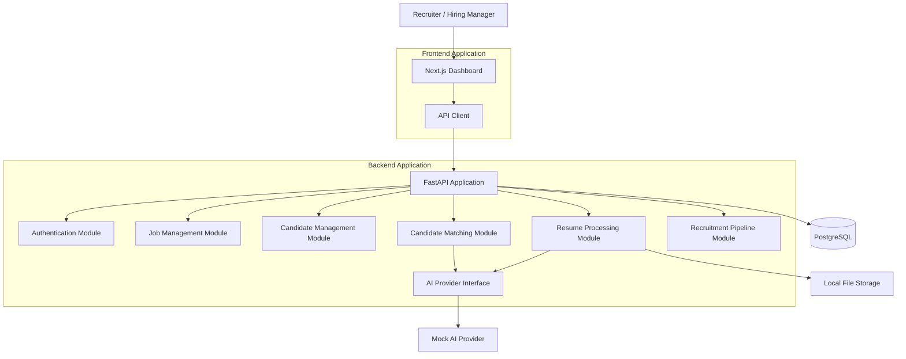
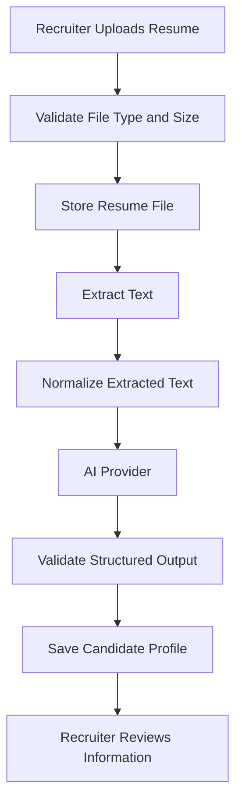

# Niyuvia — System Architecture Document

**Product:** Niyuvia  
**Category:** AI-Assisted Applicant Tracking System (ATS)  
**Document:** System Architecture Document  
**Version:** 1.0  
**Status:** Draft — Pending Review  
**Architecture Style:** Modular Monolith  
**Repository Strategy:** Monorepo  
**Initial Market:** India  
**Development Budget:** Zero-cost MVP  
**Last Updated:** 1 November 2026

---

# 1. Purpose

This document defines the technical architecture, system boundaries, technology choices, application structure, integration patterns, security principles and engineering standards for Niyuvia.

It serves as the primary technical reference for frontend development, backend development, database implementation, AI integration, testing and deployment.

The architecture must support two objectives:

1. Build a functional, demonstrable MVP without requiring paid infrastructure or subscriptions.
2. Establish a maintainable foundation that can evolve into a commercial, multi-tenant SaaS platform.

The MVP must remain simple enough for a small development team or individual developer to understand, maintain and explain.

# 2. Architecture Principles

Niyuvia will follow these architectural principles:

| Principle | Description |
|---|---|
| Simplicity | Avoid unnecessary frameworks and infrastructure. |
| Modularity | Separate business capabilities into well-defined modules. |
| Maintainability | Keep code readable, documented and testable. |
| Security | Apply secure defaults and least-privilege access. |
| Scalability | Design clear module boundaries for future growth. |
| Cost efficiency | Prefer free and locally runnable development tools. |
| Testability | Keep business logic independent of external services. |
| Explainability | AI evaluations must provide supporting evidence. |
| Human oversight | Recruiters retain control over hiring decisions. |

# 3. High-Level Architecture

Niyuvia will initially use a modular monolith architecture.

The frontend and backend will be separate applications inside one monorepository.

The backend will contain independently organized business modules within a single deployable application.



This diagram represents the logical MVP architecture. It does not imply that every module requires a separate deployment.

# 4. Technology Stack

## 4.1 Frontend

| Technology | Responsibility |
|---|---|
| Next.js | Frontend application framework |
| TypeScript | Static typing |
| React | Component-based UI |
| Tailwind CSS | Styling |
| shadcn/ui | Reusable UI components |
| React Hook Form | Form management |
| Zod | Client-side schema validation |
| TanStack Query | Server-state management |
| Lucide React | Icons |

## 4.2 Backend

| Technology | Responsibility |
|---|---|
| Python | Primary backend language |
| FastAPI | REST API framework |
| Pydantic | Request and response validation |
| SQLAlchemy 2.x | ORM and database access |
| Alembic | Database migrations |
| Pytest | Backend testing |
| Uvicorn | ASGI development server |

## 4.3 Database and Storage

| Technology | Responsibility |
|---|---|
| PostgreSQL | Primary relational database |
| Local filesystem | Development resume storage |
| SQLAlchemy | Database abstraction |
| Alembic | Schema version control |

## 4.4 AI and Document Processing

| Technology | Responsibility |
|---|---|
| Mock AI Provider | Zero-cost deterministic development |
| PyMuPDF | PDF text extraction |
| python-docx | DOCX text extraction |
| Pydantic | Structured AI response validation |
| AI Provider Interface | Future LLM provider integration |

External paid AI APIs are not mandatory for MVP development.

# 5. Monorepository Architecture

Niyuvia will maintain one Git repository containing frontend, backend, documentation, infrastructure and development scripts.

```text
niyuvia-ai/
│
├── apps/
│   ├── web/
│   │   ├── public/
│   │   ├── src/
│   │   │   ├── app/
│   │   │   ├── components/
│   │   │   ├── features/
│   │   │   ├── hooks/
│   │   │   ├── lib/
│   │   │   ├── services/
│   │   │   ├── types/
│   │   │   └── styles/
│   │   ├── tests/
│   │   ├── package.json
│   │   └── tsconfig.json
│   │
│   └── api/
│       ├── app/
│       │   ├── api/
│       │   ├── core/
│       │   ├── modules/
│       │   ├── infrastructure/
│       │   ├── schemas/
│       │   ├── services/
│       │   └── main.py
│       ├── migrations/
│       ├── tests/
│       ├── pyproject.toml
│       └── alembic.ini
│
├── docs/
│   ├── ai/
│   ├── api/
│   ├── architecture/
│   ├── database/
│   ├── development/
│   └── product/
│
├── infrastructure/
│   ├── docker/
│   └── deployment/
│
├── scripts/
│
├── .env.example
├── .gitignore
├── README.md
└── LICENSE
```

This is the target repository structure. Additional directories will be introduced only when implementation requires them.

# 6. Frontend Architecture

The frontend will use Next.js App Router with a feature-oriented structure.

## 6.1 Responsibilities

The frontend is responsible for:

- Rendering the recruiter dashboard.
- Managing user interactions.
- Displaying jobs and candidate profiles.
- Providing resume upload interfaces.
- Displaying candidate matching results.
- Managing recruitment pipeline interactions.
- Communicating with the backend API.
- Handling loading, error and empty states.

The frontend must not independently calculate authoritative candidate evaluations or access database credentials.

## 6.2 Feature Organization

The `features/` directory will contain business-oriented frontend functionality.

Proposed features:

- authentication
- dashboard
- jobs
- candidates
- resumes
- matching
- pipeline
- interviews
- analytics
- settings

Each feature may contain:

- components
- hooks
- services
- types
- validation schemas

Shared UI components belong in `components/`.

# 7. Backend Architecture

The backend will use FastAPI and a modular monolith structure.

## 7.1 Backend Responsibilities

- Authentication and authorization.
- Business rule enforcement.
- Database operations.
- Job and candidate management.
- Resume processing.
- AI provider integration.
- Candidate evaluation.
- Recruitment pipeline management.
- Audit and application activity tracking.

## 7.2 Backend Module Boundaries

| Module | Responsibility |
|---|---|
| auth | User authentication and authorization |
| organizations | Organization and membership management |
| jobs | Job creation and management |
| candidates | Internal candidate records |
| resumes | Resume uploads and extraction |
| matching | Evidence-based candidate evaluation |
| pipeline | Application stages and transitions |
| interviews | Interview scheduling and feedback |
| analytics | Recruitment metrics |
| audit | Important system activity records |

The initial MVP will prioritize the modules explicitly included in the approved MVP scope.

## 7.3 Backend Layering

Each business module should separate responsibilities where appropriate:

- `router.py` — HTTP endpoints.
- `schemas.py` — Input and output validation.
- `service.py` — Business logic.
- `repository.py` — Database access.
- `models.py` — SQLAlchemy database models.

Avoid creating unnecessary abstractions for simple operations.

HTTP routes should remain thin and delegate business logic to services.

# 8. Database Architecture

PostgreSQL will be the primary database.

SQLAlchemy will manage database access, while Alembic will manage schema migrations.

## 8.1 Initial Entity Groups

**Identity**
- users
- organizations
- organization_members

**Recruitment**
- departments
- jobs
- candidates
- resumes
- applications

**Evaluation**
- resume_extractions
- ai_runs
- ai_evaluations
- evaluation_evidence

**Workflow**
- application_events
- interviews
- interview_feedback

**Governance**
- audit_logs
- privacy_records

These are proposed logical entities. Final tables, fields, relationships and constraints will be defined in the database design document.

## 8.2 Database Standards

- Use UUID primary keys where appropriate.
- Use UTC timestamps.
- Define foreign key constraints.
- Add indexes for frequently queried fields.
- Use database migrations for schema changes.
- Avoid storing resume binary data directly in relational tables.
- Apply organization-level ownership to tenant-owned records.
- Do not rely on frontend validation for data integrity.

# 9. API Architecture

The backend will expose REST APIs.

Base path:

`/api/v1`

## 9.1 API Responsibilities

The API layer will:

- Authenticate requests.
- Validate request payloads.
- Enforce authorization.
- Execute business operations.
- Return consistent responses.
- Handle errors consistently.

## 9.2 Response Format

Successful response:

```json
{
  "success": true,
  "data": {},
  "meta": {
    "request_id": "example-request-id"
  }
}
```

Error response:

```json
{
  "success": false,
  "error": {
    "code": "VALIDATION_ERROR",
    "message": "The supplied data is invalid."
  },
  "meta": {
    "request_id": "example-request-id"
  }
}
```

## 9.3 API Versioning

All initial endpoints will use `/api/v1`.

Breaking API changes must be reviewed and documented before implementation.

OpenAPI documentation will be generated through FastAPI.

# 10. Authentication and Authorization

The MVP will support authenticated internal recruiter users.

Candidates will not have application login accounts in the initial MVP.

The authentication system must support:

- Secure password handling.
- Login and logout.
- Access-token validation.
- Role-based authorization.
- Protected backend endpoints.
- Session and token expiration policies.

Initial roles:

- Organization Administrator
- Recruiter
- Hiring Manager

Authorization must be enforced by the backend.

The frontend must never be treated as the security boundary.

# 11. AI Architecture

Niyuvia will use a provider-independent AI integration design.

The application must not depend directly on one commercial LLM provider throughout its business logic.

## 11.1 AI Components

**Resume Parser**

Responsible for:

- Extracting text from resumes.
- Identifying candidate information.
- Extracting skills and experience.
- Producing structured output.
- Validating extracted information.

**Job Analyzer**

Responsible for:

- Identifying job requirements.
- Extracting required and preferred skills.
- Identifying experience expectations.
- Producing structured job criteria.

**Candidate Matching Engine**

Responsible for:

- Comparing candidate evidence against job requirements.
- Applying approved scoring rules.
- Generating evaluation evidence.
- Producing explainable evaluation results.

## 11.2 AI Provider Abstraction

The backend will define a common AI provider interface.

Initial implementation:

`MockAIProvider`

Future implementations may include:

- OpenAI provider.
- Gemini provider.
- Other compatible LLM providers.

The mock provider must return deterministic sample outputs so that development and testing do not require paid API access.

## 11.3 AI Safety

- AI-generated information must be validated.
- Resume content must be treated as untrusted input.
- Resume instructions must never override system instructions.
- AI outputs must be distinguishable from verified candidate information.
- Evaluation results must include supporting evidence.
- Missing information must not automatically be interpreted as negative evidence.
- Protected characteristics must not be used for candidate ranking.
- AI evaluations must not automatically reject candidates.
- Final hiring decisions must remain under human control.

# 12. Resume Processing Architecture

Resume processing will follow this logical flow:



Supported initial file formats:

- PDF
- DOCX

The application must reject unsupported formats and validate uploaded files before processing.

Original resumes must remain separate from extracted candidate information.

# 13. Candidate Matching Architecture

Candidate matching will use a transparent, versioned scoring mechanism.

Initial proposed dimensions:

| Dimension | Weight |
|---|---:|
| Required skills | 45% |
| Preferred skills | 15% |
| Relevant experience | 15% |
| Project and responsibility evidence | 25% |
| **Total** | **100%** |

These weights are provisional and must be validated before being treated as final business rules.

The matching engine must:

- Evaluate candidates against approved job requirements.
- Record scoring configuration versions.
- Preserve evaluation history.
- Provide evidence for scoring dimensions.
- Separate evidence coverage from alignment score.
- Allow recruiter review and override.
- Avoid presenting scores as probabilities of hiring success.

# 14. File Storage Architecture

The MVP will use local filesystem storage for development.

Resume files must be stored outside publicly accessible frontend directories.

The storage layer should expose a consistent interface so that a private S3-compatible storage provider can be introduced later.

Storage responsibilities:

- Secure file storage.
- File metadata management.
- File retrieval.
- File validation.
- File deletion.
- Access authorization.

The application must not expose unrestricted filesystem paths to clients.

# 15. Background Processing

The initial implementation will avoid introducing unnecessary distributed infrastructure.

Short operations may execute directly through backend services.

Long-running resume extraction and AI operations must be designed so that they can move to background workers.

A future background processing implementation may use:

- Redis
- Celery
- Dedicated worker processes

These components are not mandatory for the initial zero-budget MVP.

FastAPI in-process background tasks must not be treated as a durable production job queue.

# 16. Security Architecture

Security must be considered throughout the development lifecycle.

Minimum engineering requirements:

- Password hashing using a suitable password-hashing algorithm.
- Backend authorization.
- Input validation.
- SQL injection protection through parameterized database operations.
- Secure file upload validation.
- Secrets stored in environment variables.
- No secrets committed to Git.
- CORS restricted to approved origins.
- Rate limiting before public production exposure.
- Secure error handling without leaking sensitive information.
- Audit logging for important operations.
- Organization-level data isolation.

Candidate personal information and resumes must only be accessible to authorized users.

# 17. Privacy Architecture

Niyuvia processes candidate personal information.

The system must support privacy-aware data handling.

Required design considerations:

- Clear data collection purposes.
- Appropriate privacy notices.
- Purpose limitation.
- Access controls.
- Data retention policies.
- Data correction workflows.
- Data deletion workflows.
- Candidate data export where applicable.
- Auditability of sensitive operations.
- Careful management of third-party AI providers.

Candidate resumes must not be used as model-training data by default.

The commercial release must undergo a separate legal and privacy compliance review.

# 18. Testing Architecture

Testing will be implemented at multiple levels.

| Test Type | Purpose |
|---|---|
| Unit tests | Validate individual functions and business rules |
| Integration tests | Validate database and module interactions |
| API tests | Validate HTTP endpoints and authorization |
| Frontend tests | Validate UI behavior |
| End-to-end tests | Validate complete recruiter workflows |
| Security tests | Identify common security weaknesses |

Initial testing tools:

- Pytest
- FastAPI TestClient
- Vitest
- React Testing Library
- Playwright

Critical workflows must have automated regression coverage.

# 19. Development Environment

The initial environment must be usable without paid cloud infrastructure.

Expected local dependencies:

- Node.js
- Python
- PostgreSQL
- Git
- Visual Studio Code

Development services should run locally wherever practical.

A mock AI provider will be the default development integration.

Paid hosting, paid AI APIs and commercial SaaS dependencies are not mandatory.

# 20. Deployment Architecture

The MVP may initially run locally for development and demonstration.

A future public demo deployment may use free-tier services, subject to current provider limits and availability.

The architecture must distinguish:

**Development**
- Local database.
- Local file storage.
- Mock AI provider.
- Development secrets.

**Demonstration**
- Controlled sample data.
- Restricted access.
- Clearly identified mock AI functionality where applicable.

**Commercial Production**
- Managed database.
- Private object storage.
- Production authentication.
- Secure secrets management.
- Monitoring and alerting.
- Backups and recovery.
- Background job processing.
- Tenant isolation.
- Privacy and security validation.

A successful local MVP must not be described as production-ready SaaS.

# 21. Observability and Logging

The backend should use structured logging.

Important events include:

- Authentication failures.
- API errors.
- Resume processing failures.
- AI provider failures.
- Candidate evaluation operations.
- Important recruitment stage changes.
- Administrative operations.

Logs must avoid exposing passwords, access tokens, API keys or unnecessary candidate personal information.

Future production deployment should include centralized monitoring and error tracking.

# 22. Scalability Strategy

Niyuvia will scale incrementally.

**Phase 1 — MVP**

- Modular monolith.
- Single backend application.
- PostgreSQL.
- Local development storage.
- Mock AI provider.
- Basic automated testing.

**Phase 2 — Product Validation**

- Real AI provider integration.
- Improved resume processing.
- Background processing where justified.
- Private object storage.
- Stronger monitoring.

**Phase 3 — Commercial SaaS**

- Verified multi-tenant isolation.
- Managed infrastructure.
- Production authentication.
- Tenant-level usage controls.
- Billing and subscription management.
- Backup and disaster recovery.
- Operational monitoring.

Microservices will not be introduced unless measurable engineering requirements justify the additional complexity.

# 23. Architecture Decisions

| ID | Decision | Status |
|---|---|---|
| ADR-001 | Use a monorepository | Accepted |
| ADR-002 | Use Next.js and TypeScript | Accepted |
| ADR-003 | Use FastAPI and Python | Accepted |
| ADR-004 | Use PostgreSQL | Accepted |
| ADR-005 | Use a modular monolith | Accepted |
| ADR-006 | Use a mock AI provider for zero-cost development | Accepted |
| ADR-007 | Use local filesystem storage during development | Accepted |
| ADR-008 | Keep candidates outside application authentication in MVP | Accepted |
| ADR-009 | Defer microservices | Accepted |
| ADR-010 | Defer paid infrastructure until justified | Accepted |

# 24. Architecture Constraints

The initial architecture must respect the following constraints:

1. No mandatory paid subscriptions for local MVP development.
2. No unnecessary microservices.
3. No unnecessary infrastructure dependencies.
4. No AI API keys exposed to the frontend.
5. No direct database access from the frontend.
6. No autonomous candidate rejection.
7. No public candidate portal in the initial MVP.
8. No production-readiness claims without appropriate verification.
9. No undocumented changes to core architectural decisions.

# 25. Future Architecture Reviews

Architecture must be reviewed when:

- A new major module is introduced.
- A new external provider is integrated.
- Database ownership or relationships change.
- Authentication or authorization changes.
- AI evaluation logic changes.
- Infrastructure requirements change.
- The application moves toward commercial production.

Significant architecture decisions should be documented separately as Architecture Decision Records (ADRs).

---

**Document Status:** Draft — Pending Review

**End of Document**