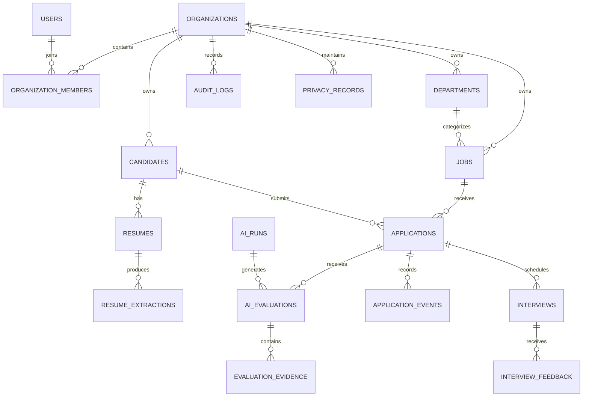

# Niyuvia — Database Design Document

**Product:** Niyuvia  
**Document:** Database Design Document  
**Version:** 1.0  
**Status:** Draft — Pending Review  
**Database Engine:** PostgreSQL  
**ORM:** SQLAlchemy 2.x  
**Migration Tool:** Alembic  
**Architecture:** Modular Monolith  
**Development Budget:** Zero-cost MVP  
**Last Updated:** 1 November 2026

---

# 1. Purpose

This document defines the logical and physical database design for Niyuvia.

It establishes:

- Database entities and relationships.
- Table responsibilities.
- Primary and foreign key conventions.
- Data types and constraints.
- Indexing strategy.
- Organization-level data ownership.
- Candidate and resume data management.
- AI evaluation data storage.
- Database migration standards.
- Data retention and deletion considerations.

This document is the primary reference for implementing SQLAlchemy models and Alembic migrations.

# 2. Database Technology

## 2.1 Selected Database

PostgreSQL will be the primary relational database.

## 2.2 Database Access

| Component | Technology |
|---|---|
| Database | PostgreSQL |
| ORM | SQLAlchemy 2.x |
| Migration | Alembic |
| Validation | Pydantic |
| Testing | Pytest |

## 2.3 Development Strategy

The database will initially run locally.

No paid managed database subscription is required for development.

Production database hosting will be evaluated separately when the project approaches commercial deployment.

# 3. Database Design Principles

The database must follow these principles:

1. Use relational integrity wherever applicable.
2. Use UUID identifiers for primary keys.
3. Use UTC timestamps.
4. Enforce appropriate foreign key constraints.
5. Avoid unnecessary duplicate data.
6. Use indexes based on actual query requirements.
7. Keep tenant-owned data associated with its organization.
8. Keep uploaded resume files outside the relational database.
9. Preserve AI evaluation history.
10. Use migrations for every schema change.
11. Avoid storing unnecessary candidate personal information.
12. Ensure sensitive data is accessible only to authorized users.

# 4. Database Naming Conventions

| Item | Convention | Example |
|---|---|---|
| Tables | Plural snake_case | candidates |
| Columns | snake_case | created_at |
| Primary keys | id | id |
| Foreign keys | referenced_table_id | organization_id |
| Indexes | ix_table_column | ix_jobs_status |
| Unique constraints | uq_table_columns | uq_users_email |
| Check constraints | ck_table_rule | ck_jobs_salary_range |
| Enum values | Uppercase | SHORTLISTED |

Table and column names must remain consistent throughout the application.

# 5. High-Level Entity Relationship Diagram

The following diagram represents the proposed logical database relationships.



This is a logical model. Final implementation relationships and cardinalities must be verified during SQLAlchemy model development.

# 6. Entity Classification

The database entities are grouped into the following domains.

| Domain | Entities |
|---|---|
| Identity | users, organizations, organization_members |
| Organization | departments |
| Recruitment | jobs, candidates, resumes, applications |
| Resume Processing | resume_extractions |
| AI | ai_runs, ai_evaluations, evaluation_evidence |
| Workflow | application_events, interviews, interview_feedback |
| Governance | audit_logs, privacy_records |

Additional tables may be introduced only when an approved requirement needs them.

# 7. Identity and Organization Tables

## 7.1 organizations

**Purpose:** Stores organization or tenant information.

| Column | Type | Constraints |
|---|---|---|
| id | UUID | Primary key |
| name | VARCHAR(200) | NOT NULL |
| slug | VARCHAR(100) | NOT NULL, UNIQUE |
| industry | VARCHAR(100) | NULL |
| website | VARCHAR(500) | NULL |
| is_active | BOOLEAN | NOT NULL, DEFAULT TRUE |
| created_at | TIMESTAMPTZ | NOT NULL |
| updated_at | TIMESTAMPTZ | NOT NULL |

## 7.2 users

**Purpose:** Stores authenticated application users.

| Column | Type | Constraints |
|---|---|---|
| id | UUID | Primary key |
| email | VARCHAR(320) | NOT NULL, UNIQUE |
| password_hash | VARCHAR(255) | NULL |
| full_name | VARCHAR(200) | NOT NULL |
| is_active | BOOLEAN | NOT NULL, DEFAULT TRUE |
| email_verified_at | TIMESTAMPTZ | NULL |
| created_at | TIMESTAMPTZ | NOT NULL |
| updated_at | TIMESTAMPTZ | NOT NULL |

Authentication implementation must determine whether password-based or managed authentication is used.

Password hashes must never be replaced with plaintext passwords.

## 7.3 organization_members

**Purpose:** Associates authenticated users with organizations and roles.

| Column | Type | Constraints |
|---|---|---|
| id | UUID | Primary key |
| organization_id | UUID | FK organizations.id, NOT NULL |
| user_id | UUID | FK users.id, NOT NULL |
| role | VARCHAR(50) | NOT NULL |
| is_active | BOOLEAN | NOT NULL, DEFAULT TRUE |
| joined_at | TIMESTAMPTZ | NOT NULL |

Unique constraint:

`UNIQUE (organization_id, user_id)`

Initial roles:

- ORGANIZATION_ADMIN
- RECRUITER
- HIRING_MANAGER

The organization context must be derived from authenticated membership, not trusted from arbitrary client-supplied identifiers.

# 8. Organization Tables

## 8.1 departments

**Purpose:** Represents departments within an organization.

| Column | Type | Constraints |
|---|---|---|
| id | UUID | Primary key |
| organization_id | UUID | FK organizations.id, NOT NULL |
| name | VARCHAR(150) | NOT NULL |
| description | TEXT | NULL |
| created_at | TIMESTAMPTZ | NOT NULL |
| updated_at | TIMESTAMPTZ | NOT NULL |

Recommended constraint:

`UNIQUE (organization_id, name)`

# 9. Recruitment Tables

## 9.1 jobs

**Purpose:** Stores job descriptions and recruitment requirements.

| Column | Type | Constraints |
|---|---|---|
| id | UUID | Primary key |
| organization_id | UUID | FK organizations.id, NOT NULL |
| department_id | UUID | FK departments.id, NULL |
| created_by | UUID | FK users.id, NOT NULL |
| title | VARCHAR(200) | NOT NULL |
| description | TEXT | NOT NULL |
| location | VARCHAR(200) | NULL |
| employment_type | VARCHAR(50) | NULL |
| work_mode | VARCHAR(50) | NULL |
| experience_min | SMALLINT | NULL |
| experience_max | SMALLINT | NULL |
| status | VARCHAR(30) | NOT NULL |
| created_at | TIMESTAMPTZ | NOT NULL |
| updated_at | TIMESTAMPTZ | NOT NULL |

Initial job statuses:

- DRAFT
- OPEN
- PAUSED
- CLOSED

Salary and compensation fields should only be introduced where the approved product requirements justify collecting them.

## 9.2 job_requirements

**Purpose:** Stores structured job requirements used for candidate matching.

| Column | Type | Constraints |
|---|---|---|
| id | UUID | Primary key |
| organization_id | UUID | FK organizations.id, NOT NULL |
| job_id | UUID | FK jobs.id, NOT NULL |
| requirement_name | VARCHAR(200) | NOT NULL |
| requirement_type | VARCHAR(30) | NOT NULL |
| importance | VARCHAR(30) | NOT NULL |
| description | TEXT | NULL |
| version | INTEGER | NOT NULL |
| created_at | TIMESTAMPTZ | NOT NULL |

Requirement types:

- SKILL
- EXPERIENCE
- PROJECT
- RESPONSIBILITY
- EDUCATION

Importance values:

- REQUIRED
- PREFERRED

Job requirement versions must remain identifiable so that previous candidate evaluations can be interpreted correctly.

## 9.3 candidates

**Purpose:** Stores internally managed candidate profiles.

Candidates are not authenticated application users in the initial MVP.

| Column | Type | Constraints |
|---|---|---|
| id | UUID | Primary key |
| organization_id | UUID | FK organizations.id, NOT NULL |
| full_name | VARCHAR(200) | NOT NULL |
| email | VARCHAR(320) | NULL |
| phone | VARCHAR(30) | NULL |
| location | VARCHAR(200) | NULL |
| professional_summary | TEXT | NULL |
| created_by | UUID | FK users.id, NOT NULL |
| created_at | TIMESTAMPTZ | NOT NULL |
| updated_at | TIMESTAMPTZ | NOT NULL |

Candidate email and phone must not be globally unique.

The same person may appear in different organizations' recruitment records.

Candidate deduplication should be organization-scoped and must not silently merge records.

## 9.4 applications

**Purpose:** Associates candidates with jobs and tracks recruitment progress.

| Column | Type | Constraints |
|---|---|---|
| id | UUID | Primary key |
| organization_id | UUID | FK organizations.id, NOT NULL |
| job_id | UUID | FK jobs.id, NOT NULL |
| candidate_id | UUID | FK candidates.id, NOT NULL |
| resume_id | UUID | FK resumes.id, NULL |
| stage | VARCHAR(40) | NOT NULL |
| applied_at | TIMESTAMPTZ | NOT NULL |
| created_by | UUID | FK users.id, NOT NULL |
| created_at | TIMESTAMPTZ | NOT NULL |
| updated_at | TIMESTAMPTZ | NOT NULL |

Initial application stages:

- APPLIED
- UNDER_REVIEW
- SHORTLISTED
- INTERVIEW_SCHEDULED
- INTERVIEW_COMPLETED
- SELECTED
- REJECTED
- WITHDRAWN
- HIRED

A candidate may apply to multiple jobs.

The same candidate should not have multiple active applications for the same job unless an explicitly approved business rule allows it.

# 10. Resume Processing Tables

## 10.1 resumes

**Purpose:** Stores resume metadata and references to stored files.

| Column | Type | Constraints |
|---|---|---|
| id | UUID | Primary key |
| organization_id | UUID | FK organizations.id, NOT NULL |
| candidate_id | UUID | FK candidates.id, NOT NULL |
| original_filename | VARCHAR(255) | NOT NULL |
| storage_key | VARCHAR(500) | NOT NULL |
| mime_type | VARCHAR(100) | NOT NULL |
| file_size_bytes | BIGINT | NOT NULL |
| checksum_sha256 | VARCHAR(64) | NULL |
| processing_status | VARCHAR(30) | NOT NULL |
| uploaded_by | UUID | FK users.id, NOT NULL |
| uploaded_at | TIMESTAMPTZ | NOT NULL |

Initial processing statuses:

- UPLOADED
- PENDING
- PROCESSING
- COMPLETED
- FAILED

The database must not store unrestricted local filesystem paths exposed to the client.

## 10.2 resume_extractions

**Purpose:** Stores structured information extracted from a resume.

| Column | Type | Constraints |
|---|---|---|
| id | UUID | Primary key |
| organization_id | UUID | FK organizations.id, NOT NULL |
| resume_id | UUID | FK resumes.id, NOT NULL |
| extraction_version | INTEGER | NOT NULL |
| extracted_data | JSONB | NOT NULL |
| extraction_status | VARCHAR(30) | NOT NULL |
| ai_run_id | UUID | FK ai_runs.id, NULL |
| created_at | TIMESTAMPTZ | NOT NULL |

The extracted JSON must be validated before it is accepted as application data.

Original resume content and extracted information must remain distinguishable.

# 11. AI Tables

## 11.1 ai_runs

**Purpose:** Records AI processing executions.

| Column | Type | Constraints |
|---|---|---|
| id | UUID | Primary key |
| organization_id | UUID | FK organizations.id, NOT NULL |
| provider_name | VARCHAR(100) | NOT NULL |
| model_name | VARCHAR(150) | NULL |
| operation_type | VARCHAR(100) | NOT NULL |
| prompt_version | VARCHAR(50) | NULL |
| schema_version | VARCHAR(50) | NULL |
| status | VARCHAR(30) | NOT NULL |
| input_hash | VARCHAR(64) | NULL |
| duration_ms | INTEGER | NULL |
| error_code | VARCHAR(100) | NULL |
| created_at | TIMESTAMPTZ | NOT NULL |

AI run statuses:

- PENDING
- RUNNING
- SUCCEEDED
- FAILED

Do not store API keys, passwords or unnecessary raw personal information in AI execution records.

## 11.2 ai_evaluations

**Purpose:** Stores candidate-to-job evaluation results.

| Column | Type | Constraints |
|---|---|---|
| id | UUID | Primary key |
| organization_id | UUID | FK organizations.id, NOT NULL |
| application_id | UUID | FK applications.id, NOT NULL |
| ai_run_id | UUID | FK ai_runs.id, NULL |
| job_requirement_version | INTEGER | NOT NULL |
| scoring_version | VARCHAR(50) | NOT NULL |
| alignment_score | NUMERIC(5,2) | NULL |
| evidence_coverage | NUMERIC(5,2) | NULL |
| evaluation_result | JSONB | NOT NULL |
| created_at | TIMESTAMPTZ | NOT NULL |

The evaluation record must identify the exact requirement and scoring configuration versions used.

An evaluation score must not be presented as a probability of hiring success.

## 11.3 evaluation_evidence

**Purpose:** Stores supporting evidence for individual evaluation dimensions.

| Column | Type | Constraints |
|---|---|---|
| id | UUID | Primary key |
| organization_id | UUID | FK organizations.id, NOT NULL |
| evaluation_id | UUID | FK ai_evaluations.id, NOT NULL |
| requirement_id | UUID | FK job_requirements.id, NOT NULL |
| evidence_text | TEXT | NULL |
| evidence_source | VARCHAR(50) | NULL |
| assessment | VARCHAR(30) | NOT NULL |
| created_at | TIMESTAMPTZ | NOT NULL |

Assessment examples:

- SUPPORTED
- PARTIALLY_SUPPORTED
- NOT_FOUND
- NEEDS_REVIEW

Missing evidence must not automatically be interpreted as proof that a candidate lacks a skill.

# 12. Recruitment Workflow Tables

## 12.1 application_events

**Purpose:** Maintains the history of application changes.

| Column | Type | Constraints |
|---|---|---|
| id | UUID | Primary key |
| organization_id | UUID | FK organizations.id, NOT NULL |
| application_id | UUID | FK applications.id, NOT NULL |
| previous_stage | VARCHAR(40) | NULL |
| new_stage | VARCHAR(40) | NOT NULL |
| changed_by | UUID | FK users.id, NOT NULL |
| notes | TEXT | NULL |
| created_at | TIMESTAMPTZ | NOT NULL |

Application history should be append-oriented.

Historical events must not be silently overwritten.

## 12.2 interviews

**Purpose:** Stores interview scheduling information.

| Column | Type | Constraints |
|---|---|---|
| id | UUID | Primary key |
| organization_id | UUID | FK organizations.id, NOT NULL |
| application_id | UUID | FK applications.id, NOT NULL |
| scheduled_at | TIMESTAMPTZ | NULL |
| duration_minutes | INTEGER | NULL |
| interview_type | VARCHAR(50) | NULL |
| status | VARCHAR(30) | NOT NULL |
| created_by | UUID | FK users.id, NOT NULL |
| created_at | TIMESTAMPTZ | NOT NULL |

Initial interview statuses:

- SCHEDULED
- COMPLETED
- CANCELLED
- RESCHEDULED

## 12.3 interview_feedback

**Purpose:** Stores structured interviewer feedback.

| Column | Type | Constraints |
|---|---|---|
| id | UUID | Primary key |
| organization_id | UUID | FK organizations.id, NOT NULL |
| interview_id | UUID | FK interviews.id, NOT NULL |
| submitted_by | UUID | FK users.id, NOT NULL |
| rating | SMALLINT | NULL |
| strengths | TEXT | NULL |
| concerns | TEXT | NULL |
| recommendation | VARCHAR(40) | NULL |
| submitted_at | TIMESTAMPTZ | NOT NULL |

Feedback must be attributable to its author.

# 13. Governance Tables

## 13.1 audit_logs

**Purpose:** Records important administrative and security-related actions.

| Column | Type | Constraints |
|---|---|---|
| id | UUID | Primary key |
| organization_id | UUID | FK organizations.id, NULL |
| actor_user_id | UUID | FK users.id, NULL |
| action | VARCHAR(100) | NOT NULL |
| resource_type | VARCHAR(100) | NOT NULL |
| resource_id | UUID | NULL |
| request_id | VARCHAR(100) | NULL |
| metadata | JSONB | NULL |
| created_at | TIMESTAMPTZ | NOT NULL |

Audit metadata must not contain credentials, access tokens or unnecessary candidate personal information.

## 13.2 privacy_records

**Purpose:** Records privacy-related activities and requests.

| Column | Type | Constraints |
|---|---|---|
| id | UUID | Primary key |
| organization_id | UUID | FK organizations.id, NOT NULL |
| candidate_id | UUID | FK candidates.id, NULL |
| record_type | VARCHAR(50) | NOT NULL |
| purpose | VARCHAR(200) | NULL |
| status | VARCHAR(30) | NOT NULL |
| recorded_at | TIMESTAMPTZ | NOT NULL |
| completed_at | TIMESTAMPTZ | NULL |
| metadata | JSONB | NULL |

This table is not a substitute for a complete privacy management process.

The final privacy model must be reviewed against applicable legal obligations before commercial release.

# 14. Relationships and Integrity Constraints

The following rules must be enforced:

1. Every job belongs to an organization.
2. Every candidate belongs to an organization.
3. Every application belongs to one organization, one job and one candidate.
4. Application job and candidate must belong to the same organization.
5. Every resume belongs to one candidate and one organization.
6. Every evaluation belongs to an application and an organization.
7. Every evaluation must reference the requirement version used.
8. Every application stage change must create an application event.
9. Every interviewer feedback record must reference an existing interview.
10. Cross-organization references must be rejected.

Where possible, use composite foreign keys containing `organization_id` to enforce organization consistency at the database level.

Application-level checks alone are not sufficient for tenant isolation.

# 15. Indexing Strategy

Indexes should support the queries used by the application.

Initial proposed indexes:

| Table | Index |
|---|---|
| organizations | UNIQUE(slug) |
| users | UNIQUE(email) |
| organization_members | UNIQUE(organization_id, user_id) |
| jobs | (organization_id, status) |
| jobs | (organization_id, created_at) |
| candidates | (organization_id, created_at) |
| candidates | (organization_id, email) |
| applications | (organization_id, job_id, stage) |
| applications | (organization_id, candidate_id) |
| resumes | (organization_id, candidate_id) |
| ai_runs | (organization_id, created_at) |
| ai_evaluations | (organization_id, application_id, created_at) |
| application_events | (organization_id, application_id, created_at) |
| interviews | (organization_id, scheduled_at) |
| audit_logs | (organization_id, created_at) |

Indexes must be reviewed using actual query patterns and PostgreSQL query plans.

Avoid adding indexes without a demonstrated need.

# 16. Data Types and Standards

## 16.1 Identifiers

Use UUID identifiers for primary keys.

## 16.2 Timestamps

Use PostgreSQL `TIMESTAMPTZ`.

Store timestamps in UTC.

Convert to the user's local timezone only for presentation.

## 16.3 Financial Values

If financial amounts are introduced, use appropriate `NUMERIC` types and an explicit currency code.

Do not use floating-point types for monetary values.

## 16.4 JSONB

Use JSONB for flexible structured information such as:

- Resume extraction results.
- AI evaluation details.
- Audit metadata.

Core relational relationships must not be hidden inside arbitrary JSON fields.

# 17. Multi-Tenant Data Isolation

Niyuvia is intended to become a multi-tenant SaaS application.

All tenant-owned data must be associated with an organization.

Initial MVP implementation must:

- Derive organization context from authenticated membership.
- Validate organization ownership on every operation.
- Prevent cross-organization resource access.
- Scope repository queries by organization.
- Test unauthorized cross-tenant access.

Future production hardening should evaluate PostgreSQL Row-Level Security (RLS).

RLS must not be claimed as implemented until its policies, connection handling and tests are complete.

# 18. Database Migration Strategy

Alembic will manage database schema changes.

Every schema change must be represented by a migration.

Migration standards:

1. Never manually change the production schema.
2. Generate migrations after model changes.
3. Review autogenerated migration files.
4. Test migrations locally.
5. Verify upgrade and rollback behavior.
6. Avoid destructive migrations without a data recovery plan.
7. Keep migration history committed to Git.

Expected commands:

```bash
alembic revision --autogenerate -m "create initial tables"
alembic upgrade head
alembic downgrade -1
alembic current
alembic history
```

# 19. Data Retention and Deletion

Candidate records and resumes may contain personal information.

The database design must support:

- Retention policy enforcement.
- Candidate data correction.
- Candidate data export where applicable.
- Deletion requests.
- Resume file deletion.
- Related extracted-data deletion.
- Appropriate audit history.
- Controlled access to historical evaluation information.

Deleting a candidate must account for dependent records and legal retention requirements.

Do not implement unrestricted cascading deletion of all historical records without reviewing the implications.

# 20. Backup and Recovery

Local development must support database export and restoration.

Production deployment must introduce:

- Automated database backups.
- Backup retention policies.
- Recovery testing.
- Documented recovery procedures.
- Appropriate backup access controls.

Backup schedules and recovery objectives will be finalized before commercial production.

# 21. MVP Database Implementation Priorities

The initial implementation should proceed in manageable phases.

## Phase 1 — Foundation

- organizations
- users
- organization_members
- departments

## Phase 2 — Recruitment

- jobs
- job_requirements
- candidates
- resumes
- applications

## Phase 3 — AI

- ai_runs
- resume_extractions
- ai_evaluations
- evaluation_evidence

## Phase 4 — Workflow

- application_events
- interviews
- interview_feedback

## Phase 5 — Governance

- audit_logs
- privacy_records

Do not create every table before the corresponding functionality is ready.

Each phase must include migrations and tests.

# 22. Open Database Decisions

The following items require final technical validation before implementation:

| ID | Decision | Status |
|---|---|---|
| DB-001 | Final authentication strategy | Pending |
| DB-002 | Final application uniqueness rule | Pending |
| DB-003 | Exact resume retention policy | Pending |
| DB-004 | Final organization-level RLS strategy | Pending |
| DB-005 | Final JSONB extraction schema | Pending |
| DB-006 | Final scoring configuration storage | Pending |
| DB-007 | Final database backup policy | Pending |

These decisions must be resolved before the relevant functionality is implemented.

# 23. Document Governance

This document must remain consistent with:

- `../architecture/ARCHITECTURE.md`
- `../architecture/ARCHITECTURE_DECISION_RECORDS.md`
- `../product/PRD.md`
- `../product/FUNCTIONAL_REQUIREMENTS.md`
- `../product/SECURITY_AND_PRIVACY_REQUIREMENTS.md`
- `../product/BUSINESS_RULES.md`

Database model changes must trigger a review of related API contracts and business rules.

---

**Document Status:** Draft — Pending Review

**End of Document**